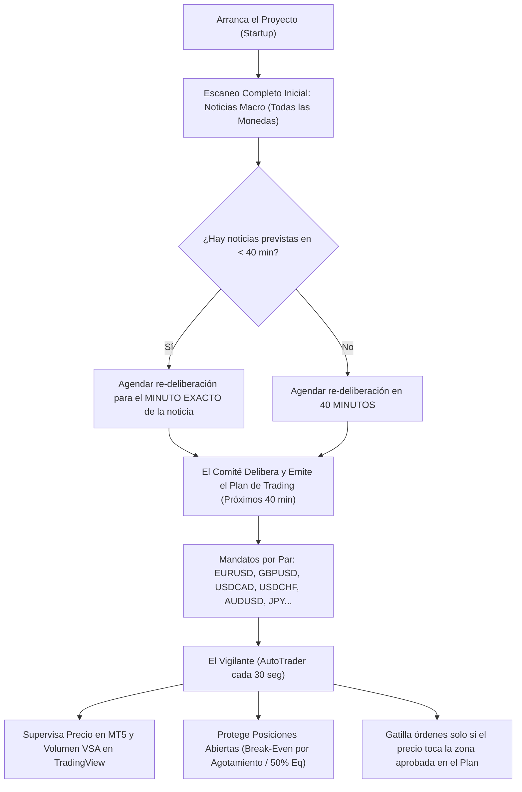

# M26 — Plan de Trading 40 Minutos y Vigilante Multi-Moneda en Tiempo Real

## 1. Visión y Filosofía Institucional

El mayor error en los bots de trading convencionales es intentar "pensar y ejecutar" en el mismo ciclo rápido (ej. cada 15 segundos o cada vela de 1 minuto). Esto genera decisiones erráticas y cambios de dirección constantes ante el ruido menor del mercado.

La arquitectura **M26** implementa el modelo de **Doble Reloj Institucional**:

---

## 2. Componentes del Sistema

### A. Servicio del Plan 40 Minutos (`api/services/plan_40m_service.py`)
- **Escaneo de Arranque:** Al iniciar el servidor FastAPI (`Runtime.startup()`), se ejecuta un análisis completo de todas las monedas de la cartera: `USD`, `EUR`, `GBP`, `CAD`, `CHF`, `JPY`, `AUD`, `NZD`.
- **Detección y Agendamiento de Noticias:**
  - Descarga el calendario económico institucional en tiempo real (`CALENDAR_JSON_URL`).
  - Filtra eventos `High` y `Medium` impact.
  - Si una noticia ocurre antes de que venzan los 40 minutos (ej. a los 20 minutos), la vigencia del plan se ajusta para terminar **exactamente en el minuto de la noticia** (`valid_to_utc = news_time`), forzando una re-deliberación inmediata con los datos frescos.
  - Si no hay noticias próximas, el plan dura **40 minutos** continuos.
- **Deliberación por Símbolo (Multi-Moneda):**
  - **Ubicación en el Rango Diario (PDL / PDH):** Calcula el porcentaje de ubicación del precio (`0% = Piso / PDL`, `100% = Techo / PDH`).
  - **Principio Premium vs. Discount:**
    - `location_pct <= 35%`: Mandato `COMPRA_EN_DISCOUNT` (buscar compras baratas en soporte/PDL/OB con objetivo al 50% Equilibrium).
    - `location_pct >= 65%`: Mandato `VENTA_EN_PREMIUM` (buscar ventas caras en resistencia/PDH/OB con objetivo al 50% Equilibrium).
    - `35% < location_pct < 65%`: Mandato `ESPERAR_ZONA` (zona de equilibrio neutral; no se entra en el medio del rango).
  - **Filtro de Noticias por Par:** Si una moneda del par tiene un evento de alto impacto en menos de 15 minutos, el par pasa automáticamente a `PAUSA_POR_NOTICIAS` para proteger la cuenta contra ensanchamiento de spreads o slippage.
  - **Fibonacci OTE (`0.618 - 0.786`):** Marca la caja institucional exacta de entrada dentro del rango.
  - **Stop Loss y Take Profit Proyectados:** Stop Loss de emergencia parametrizado (\$300 USD / 50 pips) y Take Profit hacia el 50% Equilibrium del día.
  - **Modo Manual para Oro (`XAUUSD`):** El Oro se monitorea pero queda con la etiqueta `Manual`, excluido del trading autónomo.

### B. El Vigilante en Tiempo Real (`api/services/autotrader.py` cada 30 segundos)
- **Monitoreo de Posiciones:** Cada 30 segundos revisa las órdenes abiertas en MT5:
  - Mide la ganancia en dólares y el múltiplo de R.
  - Si el precio llega al 50% Equilibrium diario o si en TradingView se detecta agotamiento de volumen institucional (`BAJO_VOLUMEN_CME` / `ALERTA_CONTRA_BALLENAS`), activa la protección inmediata a **Break-Even**.
  - Al alcanzar 2.0R, toma el 50% de ganancia parcial y deja correr el resto.
- **Filtro de Entrada:** Cuando detecta un setup en M15, consulta el **Plan de 40 Minutos vigente**:
  - Si el par está en `PAUSA_POR_NOTICIAS`, descarta la orden.
  - Si el setup es de compra pero el Comité dictó `VENTA_EN_PREMIUM` o `CONTINUIDAD_BAJISTA`, bloquea la compra.
  - Solo gatilla la orden si el precio mitiga la zona delimitada por el plan y el volumen en TradingView confirma el impulso o la absorción.

---

## 3. Interfaz de Usuario (UI)

En el modal de **⚖️ Tribunal e Inteligencia (MT5 + SMC + Web)** se añadió la pestaña:
`📋 Plan 40 Min`

### Paneles de la Pestaña:
1. **Banner de Estado del Plan:**
   - Muestra el ID del plan, vigencia exacta (`HH:MM UTC`), minutos restantes y estado (`🟢 VIGENTE` o `⏳ EN RE-DELIBERACIÓN`).
   - Próxima deliberación programada y disparador (ej. `⚡ Noticia: [USD] CPI a las 13:30 UTC` o `Ciclo regular de 40 min`).
   - Botón `⚡ Re-deliberar Ahora` para forzar un re-análisis manual instantáneo.
2. **Panel del Vigilante en Tiempo Real:**
   - Estado del vigilante (activo cada 30 segundos).
   - Lista en vivo de todas las posiciones abiertas monitoreadas con su flotante en dólares, R alcanzado y estado del seguro Break-Even.
3. **Radar de Noticias Agendadas:**
   - Lista visual de todos los eventos macroeconómicos programados para hoy para todas las monedas (`USD, EUR, GBP, CAD, CHF, JPY, AUD, NZD`), con hora UTC, impacto y divisa.
4. **Parrilla de Mandatos por Par:**
   - Tarjetas para cada par de divisas que muestran:
     - Símbolo y Mandato (`🟢 COMPRA EN DISCOUNT`, `🔴 VENTA EN PREMIUM`, `⏸️ ESPERAR ZONA`, `⚠️ PAUSA POR NOTICIA`).
     - Precio actual y ubicación (% en el rango PDL-PDH).
     - Zona de Entrada sugerida + Fibonacci OTE.
     - Parámetros de salida: SL de seguridad y TP proyectado.
     - Condición de Gatillo (Toque de zona + Barra de Volumen TradingView en M15).
     - Rationale del Comité.

---

## 4. Endpoints API

- `GET /api/analysis/eurusd-spot/plan-40m` (y alias `/api/analysis/plan-40m`):
  Retorna el estado de vigencia, minutos restantes, el plan completo de 40 minutos con los pares y el estado en tiempo real del vigilante.
- `POST /api/analysis/eurusd-spot/plan-40m/trigger` (y alias `/api/analysis/plan-40m/trigger`):
  Fuerza una re-deliberación inmediata del Comité y emite un nuevo plan de 40 minutos.

