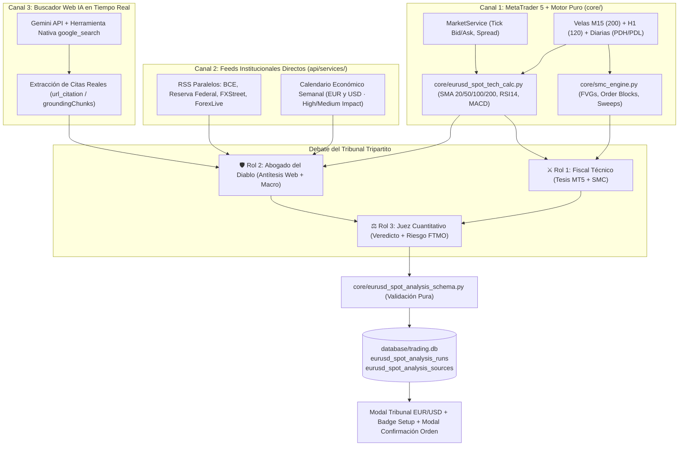

# ⚖️ Tribunal Tripartito EUR/USD — Arquitectura y Guía Operativa

> **Referencia de Decisión:** `.agent/DECISIONS.md` (`D-028`, `D-030`) · **Alcance:** Inteligencia consultiva y confluencia pre-orden para **EUR/USD** en cuentas FTMO ($25k). **Nunca auto-ejecuta órdenes**: la confirmación final sigue siendo siempre humana.

---

## 1. Propósito del Sistema

Un modelo de lenguaje tradicional que recibe un solo prompt tiende al **sesgo de confirmación**: intenta justificar una dirección única y, si no tiene acceso a internet en tiempo real, puede inventar titulares o ignorar publicaciones macroeconómicas inminentes.

El **Tribunal Tripartito EUR/USD** resuelve ambos problemas combinando:
1. **Datos 100% reales y auditables en tiempo real** desde tres canales independientes (MetaTrader 5 + SMC, feeds RSS institucionales + Calendario Económico, y Google Search Grounding nativo de Gemini).
2. **Razonamiento adversarial estructurado en 3 roles**: un **Fiscal Técnico** defiende la mejor tesis de precio/SMC, un **Abogado del Diablo** ataca esa tesis con noticias web y riesgos macro/calendario, y un **Juez Cuantitativo** emite sentencia imparcial con recomendación de riesgo FTMO (`0.50%`, `0.25%` o `0.00% VETO`).

---

## 2. Flujo de Datos y Arquitectura



### Frontera de Pureza (`AGENTS.md`)

| Módulo | Capa | Responsabilidad | ¿Hace I/O? |
| :--- | :--- | :--- | :---: |
| `core/eurusd_spot_analysis_schema.py` | `core/` | Validación estricta del JSON, normalización del bloque `tribunal`, `bank_consensus`, deduplicación de URLs y retrocompatibilidad con runs históricos. | **No (100% puro)** |
| `core/bank_consensus.py` | `core/` | Meta-análisis cuantitativo de los top 10 bancos y analistas senior (distribución de sesgos, techo institucional 100d SMA, zonas de fade, clusters de stop loss e imanes de liquidez). | **No (100% puro)** |
| `core/eurusd_spot_tech_calc.py` | `core/` | Cálculo de `SMA`, `EMA`, `RSI14`, `MACD (12,26,9)`, resumen de microestructura SMC (`summarize_smc_and_structure`) y motor determinista del Tribunal (`build_deterministic_tribunal`). | **No (100% puro)** |
| `api/services/eurusd_web_intel.py` | `api/services/` | Descarga paralela (`ThreadPoolExecutor`) de RSS y calendario macro, invocación HTTP a Gemini con `google_search` y fusión verificada de fuentes (`merge_grounded_sources`). | **Sí (HTTP/REST)** |
| `api/services/eurusd_spot_analysis_service.py` | `api/services/` | Orquestación extremo a extremo (MT5 $\rightarrow$ Web $\rightarrow$ Tribunal $\rightarrow$ Meta-Análisis Bancario $\rightarrow$ SQLite). | **Sí (MT5 + SQLite)** |
| `api/services/setup_eval.py` | `api/services/` | Cruza el setup SMC de `EURUSD` (`BUY`/`SELL`) contra el último veredicto del Tribunal en `macro_confluence`. | **Sí (lectura SQLite)** |

---

## 3. Fuentes de Datos Reales y Whitelist Institucional

### 3.1. MetaTrader 5 y Microestructura SMC
- **Tick en vivo:** Bid, Ask y Spread en puntos reales del bróker conectado.
- **Multi-timeframe:** 200 velas `M15` (rango 24h, cambio `%` 24h, medias y osciladores) + 120 velas `H1` (tendencia estructural superior).
- **Niveles institucionales:** `PDH` y `PDL` (máximo y mínimo del día anterior cerrado) + soportes/resistencias por ventanas de swing (`20`, `60`, `120` velas).
- **Patrones SMC activos (sin mitigar):** `BULLISH_FVG`, `BEARISH_FVG`, `BULLISH_OB`, `BEARISH_OB` y barridos recientes `PDH_SWEEP` / `PDL_SWEEP`.

### 3.2. Feeds Directos y Calendario Económico (Recolección Paralela ~1.5 s)
1. **Banco Central Europeo (BCE):** `https://www.ecb.europa.eu/rss/press.html` (comunicados de política monetaria y discursos).
2. **Reserva Federal (FOMC):** `https://www.federalreserve.gov/feeds/press_all.xml` (decisiones de tasas y comunicados oficiales).
3. **FXStreet News RSS:** `https://xml.fxstreet.com/news/forex-news/index.xml` (filtrando palabras clave macro/EUR/USD de las últimas 48 h).
4. **ForexLive / InvestingLive RSS:** `https://www.forexlive.com/feed/news` (flujo institucional intradía de las últimas 48 h).
5. **Calendario Económico Semanal:** `https://nfs.faireconomy.media/ff_calendar_thisweek.json`, filtrando exclusivamente eventos de **`EUR`** y **`USD`** con impacto **`High`** o **`Medium`** en la ventana `[-6h, +24h]` respecto al reloj UTC, calculando `minutes_to_event`.

### 3.3. Google Search Grounding (Gemini API) y Whitelist
Al invocar Gemini con `tools: [{"type": "google_search"}]` (API `v1beta/interactions`) o `tools: [{"google_search": {}}]` (`v1beta/models/{model}:generateContent`), Google ejecuta búsquedas reales en la web y devuelve las URLs citadas en los metadatos (`annotations` / `groundingChunks`).

`merge_grounded_sources` prioriza dominios de la lista blanca institucional (`TRUSTED_DOMAINS`):
- **Bancos centrales y organismos:** `ecb.europa.eu`, `federalreserve.gov`, `bls.gov`, `bea.gov`, `europa.eu`, `imf.org`, `bis.org`
- **Agencias financieras:** `reuters.com`, `bloomberg.com`, `ft.com`, `wsj.com`, `cnbc.com`, `marketwatch.com`
- **Portales FX especializados:** `fxstreet.com`, `forexlive.com`, `investinglive.com`, `dailyfx.com`, `investing.com`, `tradingeconomics.com`, `forexfactory.com`

---

## 4. Los 3 Roles del Debate y Niveles de Veredicto

### Roles
1. **⚔️ Fiscal Técnico (`thesis`):** Construye el argumento direccional (`BUY`, `SELL` o `NEUTRAL`) basándose en niveles exactos de MT5, alineación `M15`/`H1` y zonas SMC cercanas.
2. **🛡️ Abogado del Diablo (`antithesis`):** Busca activamente por qué la operación podría tocar Stop Loss: divergencia `M15` vs `H1`, `RSI14` agotado (`>= 68` en compras o `<= 32` en ventas), bloques SMC contrarios, titulares adversos o noticias macro de alto impacto en agenda.
3. **⚖️ Juez Cuantitativo (`verdict`):** Pondera ambos lados y dicta sentencia con estado, sesgo, confianza (`0–100`), riesgo sugerido y condición exacta de invalidación.

### Matriz de Veredictos del Juez

| Estado (`verdict.status`) | Riesgo FTMO Sugerido | Significado Operativo |
| :--- | :---: | :--- |
| `ALTA_CONFLUENCIA` | **`0.50%`** (Nominal) | Alineación técnica M15 + H1/SMC respaldada por el contexto macro y sin eventos explosivos inminentes. |
| `RIESGO_REDUCIDO` | **`0.25%`** (Mitad) | Existe ventaja técnica en M15, pero el Abogado del Diablo detectó fricción macro, evento High-Impact hoy o divergencia con H1. |
| `VETO` | **`0.00%`** (Esperar) | Publicación macroeconómica de Alto Impacto inminente (`-30` a `+90` min) o contradicción severa entre precio y catalizador fundamental. |
| `NEUTRAL` | **`0.25%`** | Mercado comprimido en rango sin desplazamiento institucional claro; esperar sweep de extremos (`PDH`/`PDL` o swing). |

### Transparencia de Origen (`tribunal.grounding_mode`)
El sistema etiqueta siempre de dónde provino la inteligencia web en cada ejecución:
- `gemini_google_search`: Gemini deliberó con búsqueda web Google Search activa + RSS + MT5.
- `rss_plus_gemini`: Gemini deliberó sobre los feeds RSS/calendario vivos + MT5 (sin citas adicionales de Google Search).
- `rss_plus_deterministic`: Sin llamada a LLM (o cuota agotada), pero usando feeds RSS/calendario reales + motor cuantitativo puro MT5/SMC.
- `deterministic_fallback`: Modo 100% local/offline usando únicamente datos de MT5/SMC y el motor determinista puro.

---

## 5. Configuración y Uso

### Variables en `.env`
```ini
# Clave de Google AI Studio (habilita la deliberación IA del Tribunal)
GEMINI_API_KEY=tu_clave_aqui

# Modelo Gemini principal vigente (cascada automática: gemini-3.8-flash -> gemini-3.5-flash-lite -> gemini-3.1-flash-lite)
GEMINI_MODEL=gemini-3.8-flash
LITELLM_MODEL=gemini-3.8-flash
```
> **Cascada Inteligente de Modelos y Cuotas (Free Tier vs. Billing):**
> 1. **Pasada 1 (`gemini_google_search`):** Intenta invocar la Interactions API (`v1beta/interactions`) con la herramienta nativa `google_search` activa.
> 2. **Pasada 2 (`rss_plus_gemini`):** Si tu clave de Google AI Studio está en capa gratuita sin cuota de `google_search` (`HTTP 429`) o un modelo reporta alta demanda (`HTTP 503`), el sistema **salta automáticamente** al siguiente modelo vigente (`gemini-3.5-flash-lite` / `gemini-3.1-flash-lite`) deliberando sobre los **titulares RSS institucionales en vivo + Calendario Macroeconómico + datos reales de MT5/SMC** ya recolectados.
> 3. **Pasada 3 (`rss_plus_deterministic` / `deterministic_fallback`):** Si `GEMINI_API_KEY` está vacía o no hay internet, ejecuta sin fallar el motor cuantitativo puro `build_deterministic_tribunal` desde `core/eurusd_spot_tech_calc.py`.

### Ejecución desde el Dashboard Web
1. Inicia el servidor: `python app.py` y abre `http://127.0.0.1:8000`.
2. Haz clic en **`📊 Análisis EUR/USD`** en la barra superior.
3. Pulsa **`⚡ Generar Ahora`** para lanzar el Tribunal en tiempo real (`POST /api/analysis/eurusd-spot/run?force=true`).
4. Al seleccionar `EURUSD` en el panel derecho (**Copilot SMC & Ejecución**) y al abrir el modal de confirmación de orden (`BUY` / `SELL`), verás automáticamente el badge del **Veredicto del Tribunal** y su recomendación de riesgo.

### Ejecución por Consola o Tarea Programada (4 sesiones/día: `07`, `11`, `14`, `18` UTC)
```powershell
cd ftmo_dashboard
python scripts/run_eurusd_spot_analysis.py --force
```
*(Añade `--no-llm` si deseas forzar únicamente el motor determinista + MT5 sin consumir API de Gemini).*

### Endpoints HTTP

| Método | Ruta | Descripción |
| :--- | :--- | :--- |
| `POST` | `/api/analysis/eurusd-spot/run?force=true` | Ejecuta el pipeline completo en vivo (MT5 + RSS + Calendario + Gemini Google Search) y guarda en `trading.db`. |
| `GET` | `/api/analysis/eurusd-spot/latest` | Devuelve el último reporte completo incluyendo `tribunal`, `bank_consensus`, `calendar_today`, `technical.smc_summary` y `sources`. |
| `GET` | `/api/analysis/eurusd-spot/history?limit=20` | Lista las ejecuciones guardadas con su `verdict_status`, `bias`, `confidence` y `price_current`. |
| `GET` | `/api/analysis/eurusd-spot/by-run?run_key=YYYY-MM-DD_HH` | Recupera el reporte íntegro de una sesión específica. |
| `GET` | `/api/analysis/eurusd-spot/bank-consensus` | Devuelve el meta-análisis estructurado y los 10 análisis de bancos y analistas senior (distribución, techo institucional, zonas de venta, cluster de stops e imán de liquidez). |
| `GET` | `/api/analysis/eurusd-spot/daily-guide` | Devuelve la **Guía Operativa Diaria** en tiempo real: semáforo de noticias, niveles maestros (Techo PDH, Medio de Camino 50%, Piso PDL), diagnóstico de ubicación y calculadora de lotaje. |

---

## 5. Meta-Análisis de Consenso Bancario Institucional (Top 10)

Integrado a partir del módulo puro `core/bank_consensus.py` y el almacén `data/eurusd_bank_analyses.json`, este subsistema cataloga las tesis vigentes de las 10 firmas más influyentes del mercado de divisas (ING, Danske Bank, Rabobank, MUFG, Scotiabank, Goldman Sachs, Société Générale, FXStreet Tech Desk, DailyFX/IG y ActionForex).

### Métricas de Convicción Agrupadas
1. **Distribución de Sesgo:** 60% Bajista, 30% Neutral/Rango, 10% Alcista.
2. **Techo Institucional (100d SMA):** `1.1280 - 1.1290` (confluencia unánime de freno técnico en D1).
3. **Zona de Venta Bancaria (Fade the Rally):** `1.1220 - 1.1260` (donde las mesas de dinero buscan posiciones cortas).
4. **Cluster de Stops de los Analistas (Zona de Sweep):** `1.1295 - 1.1300` (imán para barridas de liquidez institucional previa a giros).
5. **Imán de Liquidez / Target Bajista:** `1.1100 - 1.1150` (primer objetivo estructural masivo).

---

## 6. Guía Operativa Diaria (Copiloto Consultivo para Decisiones Manuales)

Diseñado a través de `core/daily_guide.py`, este módulo provee una pestaña dedicada en la interfaz (`🎯 Guía del Día`) que responde al instante qué se espera de la sesión actual:
1. **Semáforo Macro:** Luz Verde para condiciones de rango normal vs. Alerta por publicaciones de alto impacto con ventana horaria UTC.
2. **Mapa de Precios (Los 3 Niveles Maestros):**
   - **Techo:** `PDH` (Máximo de ayer) + distancia en pips.
   - **Medio del Camino (Take Profit):** `50% Equilibrium` exacto entre el máximo y el mínimo.
   - **Piso:** `PDL` (Mínimo de ayer) + distancia en pips.
3. **Diagnóstico de Ubicación:** Informa si el precio cotiza en zona de venta (cerca del techo), zona de compra (cerca del piso) o en el centro (zona muerta donde se recomienda no entrar).
4. **Calculadora para Cuenta Propia:** Sizing automático para cuentas de $2,000 con tope diario de $100 ($45 de riesgo por operación, 2 operaciones máximas).

---

## 7. Herramientas Visuales Interactivas: Fibonacci Pro y Cajas SMC (OB / FVG)

Integrado en el visor gráfico principal (`static/index.html` sobre TradingView Lightweight Charts + Canvas HiDPI vectorial superpuesto):
1. **Retroceso de Fibonacci Interactivo:**
   - Modo Automático (`Fib OTE Auto`) y Manual con imán magnético a mechas (`High`/`Low`).
   - Nodos interactivos de anclaje (`P1 100%` y `P2 0%`) con arrastre suave en vivo.
   - Niveles institucionales: `0.50 Equilibrium`, `0.618 Golden Pocket`, `0.705 OTE Sweet Spot`, `0.786 Deep Retracement`, Extensiones Take Profit `-0.272 (TP1)` y `-0.618 (TP2)`.
   - Etiquetas compactas posicionadas en el margen derecho exterior para no tapar las velas.
2. **Cajas SMC (Order Blocks y Fair Value Gaps):**
   - Capa interactiva (`📦 Cajas OB / FVG`) que inicia apagada por defecto para mantener el gráfico limpio.
   - Mapea cajas sombreadas institucionales en tiempo real para todos los activos y pares de divisas (`OB+`, `OB-`, `FVG+`, `FVG-`).
   - Detección automática de confluencia: si el bolsillo OTE de Fibonacci coincide con una caja viva de OB o FVG, el borde se ilumina en dorado con el distintivo `🎯 OB + OTE` o `🎯 FVG + OTE`.

---

## 8. Auditoría Empírica, Órdenes Límite y Filtro de Triple Confluencia

### 8.1 Resultados de la Auditoría Histórica (23 Runs en `trading.db` vs. MT5)
A partir de la ejecución retrospectiva contra velas reales M15 de MetaTrader 5 (`scratch/evaluate_tribunal_forecasts.py` y `EurUsdSpotAnalysisService.get_audit_metrics`):
- **Precisión Direccional a 4 Horas:** **52.2%** Tribunal Macro vs. **65.2%** Consenso de Fuentes Web/Bancarias.
- **Win Rate Táctico con Entrada a Mercado Ciega:** **22.2%** (Target +20 pips vs. SL -15 pips).
- **Excursión Adversa Máxima Promedio (MAE):** **-21.5 pips** antes de moverse en la dirección pronosticada.
- **Excursión Favorable Promedio (MFE):** **+14.9 pips** (con picos superiores a +32.8 pips).

### 8.2 Calibración a Órdenes Límite (`BUY_LIMIT` / `SELL_LIMIT`)
Debido a que el precio casi siempre realiza un retroceso de 15 a 25 pips para cazar liquidez en Order Blocks o Fibonacci OTE antes de iniciar el movimiento tendencial:
1. **`core/setup_gate.py` y `api/services/setup_eval.py`:**
   - Si el precio está extendido por encima de la zona alcista, emite `order_type: "BUY_LIMIT"` anclada al borde proximal del OB/FVG o OTE 0.618.
   - Si el precio está extendido por debajo de la zona bajista, emite `order_type: "SELL_LIMIT"`.
   - Si el precio ya está mitigando/dentro de la zona, permite ejecución a mercado.
   - El Stop Loss estructural queda blindado tras el borde distal de la zona (+ spread de seguridad).
2. **Copilot Panel (`static/index.html`):**
   - El veredicto refleja el tipo de orden (`APROBADO (BUY LIMIT)` / `APROBADO (SELL LIMIT)`).
   - Los botones de compra/venta y el modal de confirmación muestran el precio límite exacto y la etiqueta `(Pullback Limit OB/OTE)`.

### 8.3 Filtro de Triple Confluencia en AutoTrader (`api/services/autotrader.py`)
AutoTrader cuenta con la regla `autotrader_triple_confluence: true` (declarada en `config/strategy.yaml` y validada por `core/strategy.py`):
1. **Confluencia 1 (Tribunal Macro & Consenso Web):** Exige consenso favorable (>50%) de bancos/analistas y que el Tribunal no se encuentre en `VETO` ni con sesgo contrario al trade.
2. **Confluencia 2 (Killzone Activa):** Exige que la operación caiga dentro de las sesiones de alto volumen institucional (Londres 07:00-10:00 UTC o Nueva York 12:30-15:30 UTC).
3. **Confluencia 3 (Mitigación de Zona):** Verifica que el precio no haya despegado ya en persecución (deriva máxima 3.5 pips). Si se alejó, rechaza la persecución y espera el retroceso a la zona de entrada.

### 8.4 Scorecard Visual en la UI
Disponible mediante el endpoint `GET /api/analysis/eurusd-spot/audit-metrics` y la nueva pestaña **`📊 Auditoría / Scorecard`** dentro del modal EUR/USD de `static/index.html`:
- Tarjetas KPI en vivo (Acierto Consenso Web 65.2%, Acierto Tribunal 52.2%, Win Rate Mercado Ciego 22.2%, MAE -21.5p, MFE +14.9p).
- Resumen ejecutivo de calibraciones institucionales.
- Tabla interactiva run por run con etiquetas de acierto/fallo y desglose pips 4h/8h.
